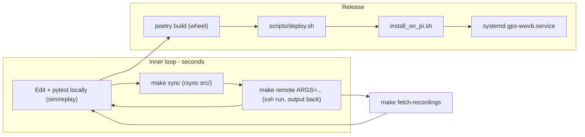

# GPS + WWVB Poetry project for tec-pi-wwv

## Hardware map (confirmed from your scan and the vendor docs)
- `0x19` LSM303 accelerometer, `0x1E` LSM303 magnetometer
- `0x32` ES100 (decimal 50, the library default)
- `0x42` u-blox MAX-M8Q I2C port (u-blox calls it "DDC")
- GPIO: the GPS HAT uses PPS on BCM18 and INT on BCM27. The ES100 IRQ goes to physical pin 11 (BCM17) and EN to physical pin 7 (BCM4), so nothing collides. The UART isn't needed because the GPS is read over I2C.
- The `es100` library uses `GPIO.BOARD` numbering, so the config stores `irq = 11` and `en = 7` (physical pin numbers).
- Host: Pi Zero 2 W (512 MB RAM, swap already configured), 64-bit Trixie, networked through the PoE/ETH/USB HUB HAT.

## Key decisions
- **Local dev cannot install `es100-wwvb` cleanly.** It hard-depends on `RPi.GPIO` and `smbus`, which are C extensions. Locally (Python 3.14, x86) the app runs against a simulator or replay backend, and `es100` is imported lazily, only on the Pi.
- **On Trixie, PyPI `RPi.GPIO` has broken `wait_for_edge`** because of the newer kernel's GPIO numbering, and `es100` relies on that call. On the Pi we therefore use apt's `python3-rpi-lgpio`, a drop-in replacement that provides the `RPi.GPIO` module, plus `python3-smbus`. Venvs are created with `--system-site-packages`, and `es100-wwvb` is installed with `pip install --no-deps`.
- **No Cursor Remote-SSH on the Pi.** Its server is too heavy for 512 MB of RAM. Code is edited locally. The Pi only receives synced files and runs commands over SSH, which the Cursor agent can drive itself.
- **Two separate install locations on the Pi** so dev runs and the service never overwrite each other:
  - `~/src/gps_wwvb-dev`: editable install, updated by rsync of `src/` (about 1 second per sync)
  - `~/src/gps_wwvb`: release install from a wheel, run by systemd
- **Only one process may use the ES100 and I2C devices at a time.** Dev targets stop `gps-wwvb.service` before running and print a reminder to restart it.

## Project layout
- [pyproject.toml](pyproject.toml): `python = ">=3.11,<3.15"`. Runtime deps: `smbus2` and `pyubx2`. Dev group: `pytest`, `ruff`, `debugpy`. Console script: `gps-wwvb = "gps_wwvb.cli:main"`.
- [src/gps_wwvb/config.py](src/gps_wwvb/config.py): reads a TOML config (via `tomllib`) from `./gps_wwvb.toml`, `~/.config/gps_wwvb.toml`, or `/etc/gps_wwvb.toml`. Settings: I2C bus 1, device addresses, ES100 pins, magnetic declination, compass calibration offsets, log path.
- [src/gps_wwvb/geo.py](src/gps_wwvb/geo.py): great-circle distance and bearing to WWVB (40.678062N, 105.046688W), and signal travel time at 299,250 km/s (the same model as `es100-wwvb`).
- [src/gps_wwvb/devices/gps_ubx.py](src/gps_wwvb/devices/gps_ubx.py): reads the u-blox over I2C with `smbus2.i2c_rdwr`. It reads registers `0xFD`/`0xFE` (bytes available), then the stream at `0xFF`, and wraps that as a file-like object for `pyubx2.UBXReader`. At startup it sends UBX config to enable NAV-PVT at 1 Hz on the I2C port. It returns a `GpsFix` with lat, lon, alt, UTC time, fix type, validity flags, time accuracy, and the system time when the message arrived.
- [src/gps_wwvb/devices/compass.py](src/gps_wwvb/devices/compass.py): a small `smbus2` LSM303 driver. It detects the DLHC vs AGR variant from ID registers (AGR mag reports WHO_AM_I `0x4F` = `0x40`). It provides tilt-compensated heading, hard-iron calibration (min/max sweep), and declination correction to true north.
- [src/gps_wwvb/devices/wwvb.py](src/gps_wwvb/devices/wwvb.py): wraps `es100.ES100(irq, en, bus, address)`. `receive()` calls `.time()` and returns a `WwvbReading` with WWVB time, system time at the IRQ, antenna, DST flag, and leap-second flag.
- [src/gps_wwvb/devices/sim.py](src/gps_wwvb/devices/sim.py): fake GPS, compass, and ES100 with the same interfaces. Simulation is used when `--simulate` is passed or when not running on ARM Linux.
- [src/gps_wwvb/devices/replay.py](src/gps_wwvb/devices/replay.py): plays back files produced by `record`, using the same interfaces as the real devices. Selected with `--replay DIR`.
- [src/gps_wwvb/monitor.py](src/gps_wwvb/monitor.py): the core loop.
  - A GPS thread keeps the latest fix and a running offset between GPS time and the system clock.
  - The main thread blocks on ES100 reception. For each reception it computes the corrected WWVB time (WWVB time plus travel time computed from the GPS position) and maps the ES100's IRQ system timestamp onto GPS time. It then logs the WWVB vs GPS offset in milliseconds, plus antenna, distance, bearing, and day/night status.
  - Results go to the console and a CSV/JSONL file.
  - Precision is limited by the I2C polling jitter of a few ms on GPS. The PPS line on BCM18 is a possible later upgrade.
- [src/gps_wwvb/cli.py](src/gps_wwvb/cli.py) (argparse) subcommands:
  - `status`: one-shot read of all three devices
  - `run`: long-running monitor (used by systemd)
  - `compass`: live heading, bearing to WWVB, and how far to rotate the antenna. The ES100 ferrite antennas receive best when they are broadside to the transmitter.
  - `calibrate-compass`: rotate the board, then write the offsets to the config file
  - `record --out DIR --duration N`: saves raw GPS I2C bytes (with timestamps), raw compass samples, and ES100 readings as JSONL/binary files
- [tests/](tests/): `test_geo.py` (known distances and bearings), `test_gps_ubx.py` (parse recorded UBX bytes through a fake bus), `test_compass.py` (heading math), `test_monitor.py` (offset calculation with simulated and replayed devices). Recordings from the real Pi live in `tests/data/`.

## Development loop (day to day)
- **One-time Pi prerequisites**
  - SSH key login with a `Host tec-pi-wwv` entry in `~/.ssh/config`, so no command ever waits on a password prompt
  - `rsync` installed on both machines
  - swap is already present
- [Makefile](Makefile) dev targets (all host details come from `PI_HOST ?= tec-pi-wwv` and `PI_DEV_DIR ?= ~/src/gps_wwvb-dev`):
  - `dev-setup`: runs the apt/I2C/groups steps from `install_on_pi.sh`, rsyncs `pyproject.toml`, `README.md`, `src/`, and `gps_wwvb.toml`, creates `.venv --system-site-packages` in `PI_DEV_DIR`, then runs `pip install --no-deps es100-wwvb` and `pip install -e .` (plus `debugpy`)
  - `sync`: `rsync -az --delete src/ gps_wwvb.toml $(PI_HOST):$(PI_DEV_DIR)/...`. Only needs re-running `dev-setup` when dependencies change.
  - `remote ARGS="status"`: stops the service, syncs, then runs `ssh -t $(PI_HOST) '$(PI_DEV_DIR)/.venv/bin/gps-wwvb $(ARGS)'`
  - `watch`: re-runs `sync` on file changes, using `watchexec` if installed locally
  - `fetch-recordings`: runs `record` remotely, then rsyncs the output into `tests/data/<timestamp>/`
  - `debug ARGS="status"`: starts `python -m debugpy --listen 127.0.0.1:5678 --wait-for-client -m gps_wwvb.cli $(ARGS)` on the Pi over `ssh -L 5678:localhost:5678`
  - `run-sim`, `test`, `lint`: local only
- [.vscode/launch.json](.vscode/launch.json):
  - "Attach to tec-pi-wwv": debugpy attach to `localhost:5678`, with `pathMappings` from `${workspaceFolder}/src` to `/home/<user>/src/gps_wwvb-dev/src`
  - "Run simulated": local launch of `gps_wwvb.cli run --simulate`
- [.cursor/rules/pi-dev.mdc](.cursor/rules/pi-dev.mdc): tells the agent that the Pi can't be developed on directly. It should use `make test` / `make run-sim` locally, then `make remote ARGS=...` to check against real hardware, and `make fetch-recordings` to turn real-world problems into tests. It must never run `pip install` or build anything heavy on the Pi outside `dev-setup` / `install_on_pi.sh`.

## Release deployment
- [scripts/deploy.sh](scripts/deploy.sh): runs `poetry build`, then `rsync dist/ deploy/ gps_wwvb.toml $(PI_HOST):~/src/gps_wwvb/`, then `ssh $(PI_HOST) ~/src/gps_wwvb/deploy/install_on_pi.sh`. Restarts the service by default. Exposed as `make deploy`.
- [deploy/install_on_pi.sh](deploy/install_on_pi.sh), safe to re-run:
  - `apt install python3-venv python3-smbus python3-rpi-lgpio python3-ephem python3-sysv-ipc i2c-tools rsync`
  - `raspi-config nonint do_i2c 0`
  - add the user to the `i2c` and `gpio` groups
  - create the venv `~/src/gps_wwvb/.venv --system-site-packages`
  - `pip install --no-deps es100-wwvb`, then `pip install --force-reinstall --no-deps dist/gps_wwvb-*.whl`, plus its pure-Python deps (`smbus2`, `pyubx2`)
  - install and enable the systemd unit, copying `gps_wwvb.toml` to `/etc/gps_wwvb.toml` if it isn't already there
- [deploy/gps-wwvb.service](deploy/gps-wwvb.service): runs `~/src/gps_wwvb/.venv/bin/gps-wwvb run` as the user, with `Restart=on-failure`.
- Release Makefile targets:
  - `build`
  - `deploy`
  - `remote-status` (`ssh $(PI_HOST) systemctl status gps-wwvb`)
  - `logs` (`ssh $(PI_HOST) journalctl -u gps-wwvb -f`)
  - `svc-start` / `svc-stop`
- [README.md](README.md) covers wiring, first-time Pi setup, the dev loop, debugging, and release deploys.

## Notes
- The ES100 cannot receive from HH:10 to HH:16 or from HH:40 to HH:46. The monitor logs these windows as expected gaps.
- Nothing compiles on the Pi. Everything there is pure Python or comes from apt.
- I won't mount the Pi's filesystem locally with SSHFS. Cursor's indexing and git are slow over it, and it breaks the local test loop.
- Before the first `dev-setup`, I'll check passwordless SSH with `ssh -o BatchMode=yes tec-pi-wwv true`.
