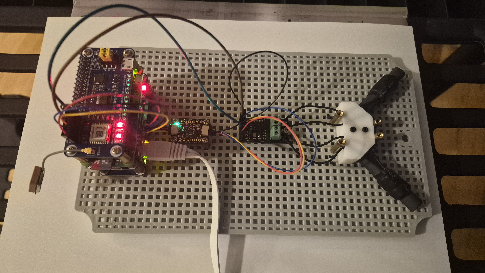
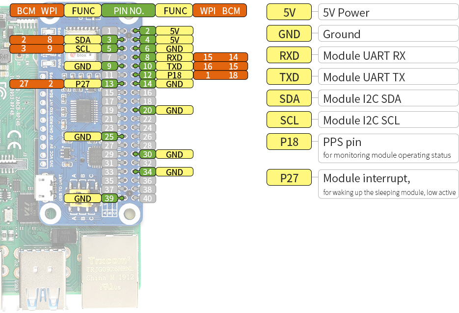

# gps-wwvb

Reads a u-blox MAX-M8Q GPS through `gpsd` (UART `/dev/ttyS0` plus hardware PPS on `/dev/pps0`), an ES100 WWVB receiver, and an LSM303 compass. Each WWVB reception is corrected for the radio travel time from the GPS fix, then compared with GPS time. The compass heading is shown against the bearing to WWVB so the open end of the antenna V can be pointed at the transmitter.

The receiver is a Pi Zero 2 W named `tec-pi-wwv` (64-bit Raspberry Pi OS Trixie, 512 MB of RAM). Code is edited on this machine. The Pi only runs commands over SSH.

## Hardware



I2C is the Pi's standard bus 1 (physical pins 3 and 5, SDA and SCL).

| Device | Interface / Address | Notes |
| --- | --- | --- |
| [LSM303 accelerometer](https://learn.adafruit.com/lsm303-accelerometer-slash-compass-breakout) | I2C `0x19` | DLHC or AGR, detected at startup |
| [LSM303 magnetometer](https://learn.adafruit.com/lsm303-accelerometer-slash-compass-breakout) | I2C `0x1E` | AGR reports WHO_AM_I `0x4F` = `0x40` |
| [ES100 WWVB](https://www.universal-solder.ca/product/everset-es100-wwvb-bpsk-atomic-clock-starter-kit/) | I2C `0x32` | Also needs the IRQ and EN lines below |
| [MAX-M8Q GPS](https://www.waveshare.com/wiki/MAX-M8Q_GNSS_HAT) | `gpsd` (`127.0.0.1:2947`) | UART `/dev/ttyS0` + PPS `/dev/pps0` (BCM18). Avoids Pi Zero I2C clock-stretching corruption on the u-blox DDC port |

The ES100 has two GPIO lines besides I2C. [es100-wwvb](https://pypi.org/project/es100-wwvb/) recommends this wiring, and that is how this board is connected:

| ES100 signal | GPIO | Physical pin | `gps_wwvb.toml` |
| --- | --- | --- | --- |
| IRQ | 17 | 11 | `irq = 11` |
| EN | 4 | 7 | `en = 7` |




The library takes `GPIO.BOARD` numbers, so the config stores physical pins 11 and 7. GPIO 17 and GPIO 4 leave the GPS HAT's PPS (BCM18), INT (BCM27), and UART (`/dev/ttyS0`, physical pins 8 and 10) free for `gpsd`.

The ES100 has two ferrite rods in a V. The open end of the V points along the LSM303 +X axis, and that opening should face WWVB so the rods split the signal. Heading 0 means +X points magnetic north, increasing clockwise. Declination comes from the World Magnetic Model at the GPS fix (east positive): `true = magnetic + declination`.

WWVB is off the air from minute 10 to 16 and from minute 40 to 46 of each hour. The monitor logs those windows and does not start a reception.

## Local setup

```bash
poetry install
make test
make coverage
make lint
make run-sim
```

`run --simulate` (also the default on anything that is not ARM Linux) pretends the receiver is in San Jose, so the report shows about 1501.7 km, bearing 70.6 degrees, and 5.018 ms of travel time.

`make test` writes `reports/test.html`, `reports/test.xml`, and a coverage report (`reports/coverage/index.html`, `reports/coverage.xml`), the same layout as WeatherWatch. `make coverage` reruns the tests and prints the per-file summary. `make lint` runs Ruff, mypy, and pylint; `make format` applies Ruff's fixes and formatter.

## Configuration

`gps-wwvb` reads `--config`, then `~/.config/gps_wwvb.toml`, then `/etc/gps_wwvb.toml`. The working directory is not searched; `make run-sim` and `make remote` pass `--config gps_wwvb.toml`. The service uses `/etc/gps_wwvb.toml`, which stays owned by root. A later release install does not overwrite that file.

Compass offsets and the `calibrated` flag for that system file are stored in `/var/lib/gps-wwvb/calibration.toml`, owned by the service user. Any other config file keeps those values in itself.

## Commands

```bash
gps-wwvb status
gps-wwvb run
gps-wwvb compass
gps-wwvb orientate
gps-wwvb --config /etc/gps_wwvb.toml calibrate
gps-wwvb calibrate-compass --duration 30
gps-wwvb record --out recordings/sample --duration 60
gps-wwvb --replay recordings/sample status
```

`run` appends JSONL (or CSV, if `log.format` is `csv`). Process messages go through the packaged `gps_wwvb/logging.yml` (override the file with `GPS_WWVB_LOG_CONFIG`): a console handler and a 2 MB rotating file, the same shape as WeatherWatch. `GPS_WWVB_LOG_LEVEL` (default `INFO`), `GPS_WWVB_LOG_PATH`, and `GPS_WWVB_LOG_NAME` override the level and file. `GPS_WWVB_NO_CONSOLE=1` keeps the file only. A reception is one INFO line whose message is:

```text
2026-11-01 12:00:00Z offset +1.2 ms  ant 1  1501.7 km  brg 70.6  hdg 70.6  dec +12.7  turn +0.0  day  fix 0.2s
```

`offset` is corrected WWVB time minus GPS time at the ES100 interrupt. Positive means WWVB looks later than GPS. `gpsd` supplies both the position/time (`TPV`/`SKY` over `/dev/ttyS0`) and the hardware PPS/timing offset (`PPS` on `/dev/pps0`, with `TOFF` as fallback), avoiding the NMEA serial burst delay and the Pi Zero's I2C clock-stretching corruption on the u-blox DDC port.

`run` on the Pi exits 3 until `calibrated` is true, and the service unit does not restart on that exit or on a bad config file (exit 2). `calibrate` asks you to rotate the board for the magnetometer sweep, then to point the open end of the V at WWVB. It marks the calibration file calibrated only after +X stays within 5 degrees of that bearing. `--aim-only` repeats that aim check with the offsets already saved. `calibrate-compass` writes the magnetometer offsets and leaves the monitor stopped. For `/etc/gps_wwvb.toml` those writes go to `/var/lib/gps-wwvb/calibration.toml`. `orientate` prints the heading +X is pointing, the bearing to WWVB, and `off`, the signed degrees still to turn. Positive `off` means turn the board clockwise. `fix` on a reception line is how many seconds have passed since the GPS sample in use.

## Pi, first time

Passwordless SSH has to work before any Make target will:

```bash
ssh -o BatchMode=yes tec-pi-wwv true
```

`~/.ssh/config` needs a `Host tec-pi-wwv` entry (same shape as the other `tec-*` hosts). `sudo` on the Pi needs to work without a password prompt, because the setup commands are not interactive. Copying files uses `rsync` when it is installed, and tar over SSH otherwise.

```bash
make dev-setup
```

That installs the apt packages (`python3-rpi-lgpio` provides `RPi.GPIO`; the PyPI `RPi.GPIO` build has a broken `wait_for_edge` on this kernel), enables I2C, creates `~/src/gps_wwvb-dev/.venv` with `--system-site-packages`, and installs the locked requirements from `requirements.txt`, `es100-wwvb` 0.4.4 with `--no-deps`, plus an editable install of this package. Nothing is compiled on the Pi. `make requirements` regenerates `requirements.txt` from `poetry.lock`.

Log out of the Pi and back in if a later command reports a permissions error on `/dev/i2c-1`. New group membership does not apply to the current session.

## Day to day

```bash
make test                 # local simulator and replay tests
make sync                 # rsync src/ and the dependency files (about a second)
make dev-deps             # sync, then install requirements.txt into the dev venv
make remote ARGS='status' # stop the service, sync, run on the Pi
make watch                # sync whenever src/ changes (watchexec if installed)
make fetch-recordings DURATION=60
make svc-start            # start the release service again when you are done
```

`make sync` copies `pyproject.toml`, `poetry.lock`, and `requirements.txt` along with `src/`. It does not install them. After a dependency change, run `make dev-deps` so the existing dev virtualenv picks up `requirements.txt`. `make dev-setup` is the first-time setup that creates that virtualenv.

`make remote` leaves `gps-wwvb.service` stopped. Only one process can use the ES100 and the I2C bus.

Recordings land in `tests/data/<timestamp>/`. Replay them with `--replay` or point a test at the directory. `make debug ARGS='status'` starts `debugpy` on the Pi and forwards port 5678. The "Attach to tec-pi-wwv" launch config expects the dev tree at `/home/tcronin/src/gps_wwvb-dev/src`; change `remoteRoot` if the Pi user is different.

## Release

```bash
make deploy
make remote-status
make logs
```

`scripts/deploy.sh` builds a wheel, copies it to `~/src/gps_wwvb`, and runs `deploy/install_on_pi.sh`. The unit runs:

```text
~/src/gps_wwvb/.venv/bin/gps-wwvb --config /etc/gps_wwvb.toml run
```

The dev tree (`~/src/gps_wwvb-dev`) and the release tree (`~/src/gps_wwvb`) do not overwrite each other.
