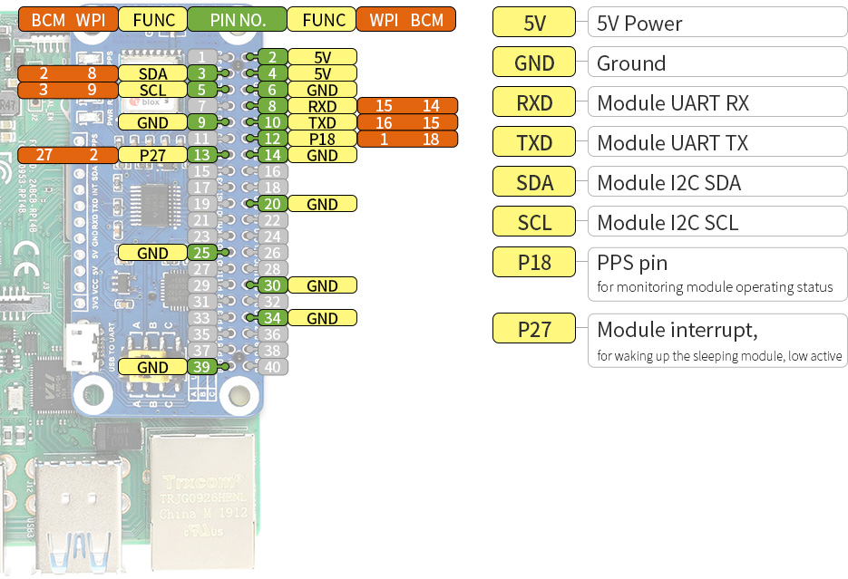

# Board Configuration, Serial Settings, and LED Control

This guide supplements the main [README](../README.md) with details on the Waveshare MAX-M8Q GNSS HAT hardware settings, controlling or dimming onboard LEDs, and configuring the u-blox MAX-M8Q receiver over the serial port (`/dev/ttyS0`) with `ubxtool`.

## Hardware Overview and Jumper Selection



On the [Waveshare MAX-M8Q GNSS HAT](https://www.waveshare.com/wiki/MAX-M8Q_GNSS_HAT):

- **UART Selection Jumpers (`A`, `B`, `C`):**
  - **Position `B` (required for Raspberry Pi):** Connects the MAX-M8Q UART (`TXD`/`RXD`) to the Raspberry Pi GPIO header (`BCM15` / physical pin 10 and `BCM14` / physical pin 8, exposed as `/dev/ttyS0`).
  - **Position `A`:** Connects the MAX-M8Q to the HAT's onboard CP2102 `USB TO UART` micro-USB port (for direct connection to a PC running u-center).
  - **Position `C`:** Connects the Raspberry Pi UART to the HAT's `USB TO UART` micro-USB port.
- **PPS and Interrupt Pins:**
  - **`PPS` (`BCM18` / physical pin 12):** Connected to the MAX-M8Q `TIMEPULSE` (`TP1`) output and read by the Linux `pps-gpio` driver as `/dev/pps0`.
  - **`INT` (`BCM27` / physical pin 13):** Connected to the MAX-M8Q `EXTINT` wakeup/interrupt input (active low).
- **Backup Battery (`ML1220`):**
  - The battery holder on the underside of the HAT takes a **rechargeable `ML1220`** lithium cell to keep the MAX-M8Q's battery-backed RAM (BBR) and RTC alive across power cycles so saved `ubxtool` settings (`-p SAVE`) and satellite ephemerides persist when unplugged.

---

## Controlling and Dimming Onboard LEDs

There are several indicator LEDs across the stack. Most are hardwired to power rails or data lines, while the `PPS` LED and the Raspberry Pi's `ACT` LED can be controlled in software:

| Board / LED | Color | How It Is Wired | Software / Serial Control |
| --- | --- | --- | --- |
| **MAX-M8Q HAT `PWR`** | Red | Hardwired to the 3.3 V power rail | **No.** Always on while powered (cover with tape or desolder its series resistor to disable). |
| **MAX-M8Q HAT `PPS`** | Red | Driven by MAX-M8Q `TIMEPULSE` (`TP1`), shared with `BCM18` (`/dev/pps0`) | **Yes, via `ubxtool` over `/dev/ttyS0`.** Can be shortened from 100 ms to 50 µs so the flash is virtually invisible while `/dev/pps0` continues working (see below), or disabled completely with `-d PPS`. |
| **MAX-M8Q HAT `TXD` / `RXD`** | Red | Hardwired to the UART `TXD` and `RXD` lines | **Not directly.** `RXD` stays off while `gpsd` runs in read-only mode (`-b`). `TXD` flashes during each 1 Hz NMEA burst; increasing the baud rate or disabling unused messages shortens the blink. |
| **Pi Zero 2 W `ACT`** | Green | Raspberry Pi GPIO status LED | **Yes, via Linux `sysfs` or `/boot/firmware/config.txt`** (see below). |
| **Adafruit LSM303** | Green | Hardwired to the breakout's 3.3 V regulator | **No.** Always on while powered. |

### 1. Dimming the HAT `PPS` LED Without Disabling `/dev/pps0`

By default, the MAX-M8Q outputs a **100 ms (`100,000 µs`)** pulse once per second when locked, causing a bright 1 Hz flash on the `PPS` LED. Because the Linux kernel `pps-gpio` driver on `/dev/pps0` latches the rising edge in an interrupt handler, it does not need a 100 ms pulse.

Shortening the locked pulse width in `UBX-CFG-TP5` from `100000` µs (100 ms) to `50` µs (0.05 ms — a 2,000× reduction in duty cycle) makes the LED flash nearly imperceptible while keeping `/dev/pps0` timing active:

```bash
sudo systemctl stop gpsd.socket gpsd.service
# CFG-TP5: tpIdx=0, antCableDelay=2ns, rfGroupDelay=0ns, freqPeriod=1000000us (1Hz),
#          freqPeriodLock=1000000us (1Hz), pulseLenRatio=0us (unlocked),
#          pulseLenRatioLock=50us (locked), userConfigDelay=0ns, flags=0x77
sudo ubxtool -f /dev/ttyS0 -s 9600 -p CFG-TP5,0,2,0,1000000,1000000,0,50,0,0x77
sudo ubxtool -f /dev/ttyS0 -s 9600 -p SAVE
sudo systemctl start gpsd.socket gpsd.service
```

To restore the factory 100 ms (`100000` µs) pulse width:

```bash
sudo systemctl stop gpsd.socket gpsd.service
sudo ubxtool -f /dev/ttyS0 -s 9600 -p CFG-TP5,0,2,0,1000000,1000000,0,100000,0,0x77
sudo ubxtool -f /dev/ttyS0 -s 9600 -p SAVE
sudo systemctl start gpsd.socket gpsd.service
```

*(Note: Running `sudo ubxtool -f /dev/ttyS0 -s 9600 -d PPS` turns the `TIMEPULSE` pin off completely, which also stops `/dev/pps0` updates. Use `-e PPS` to re-enable it.)*

### 2. Turning Off the Raspberry Pi Zero 2 W Green `ACT` LED

To turn off the Pi's green activity LED immediately (until the next reboot):

```bash
echo none | sudo tee /sys/class/leds/ACT/trigger
echo 0 | sudo tee /sys/class/leds/ACT/brightness
```

To keep it off across reboots, add these lines to `/boot/firmware/config.txt`:

```ini
dtparam=act_led_trigger=none
dtparam=act_led_activelow=off
```

---

## MAX-M8Q Settings Controllable Over Serial (`/dev/ttyS0`)

Because `gpsd` runs in read-only mode (`-b`) and attaches both `/dev/ttyS0` and `/dev/pps0`, stop `gpsd.socket` and `gpsd.service` before running `ubxtool -f /dev/ttyS0 -s 9600`, then save changes to battery-backed RAM with `-p SAVE` and restart `gpsd`.

### 1. Dynamic Platform Model (`UBX-CFG-NAV5`)

The factory default model is `0` (*Portable*). For a stationary timing and WWVB receiver, setting model `2` (*Stationary*) constrains the navigation filter for a non-moving antenna, reducing position wander and timing jitter:

| Model Value | Platform Mode | Description |
| --- | --- | --- |
| `0` | Portable | Default general-purpose mode |
| `2` | **Stationary** | **Recommended for fixed clock/timing installations** (zero velocity constraint) |
| `3` | Pedestrian | Low-speed motion (< 30 m/s) |
| `4` | Automotive | Ground vehicle dynamics |
| `5` | Sea | Zero vertical velocity assumption |
| `6` / `7` / `8` | Airborne `<1g` / `<2g` / `<4g` | High-dynamic airborne modes |

```bash
sudo systemctl stop gpsd.socket gpsd.service
sudo ubxtool -f /dev/ttyS0 -s 9600 -p MODEL,2
sudo ubxtool -f /dev/ttyS0 -s 9600 -p CFG-NAV5 -v 2
sudo ubxtool -f /dev/ttyS0 -s 9600 -p SAVE
sudo systemctl start gpsd.socket gpsd.service
```

### 2. GNSS Constellations (`UBX-CFG-GNSS`)

The MAX-M8Q can track up to 3 major constellations concurrently: **GPS + Galileo** (sharing the 1575.42 MHz L1 RF path) plus either **GLONASS** (1602 MHz) or **BeiDou** (1561 MHz), alongside **SBAS** and **QZSS**.

- **Enable (`-e`) or disable (`-d`) constellations:**
  - `GPS`, `GALILEO`, `GLONASS`, `BEIDOU`, `SBAS`, `QZSS`
- **Inspect active constellations:**
  ```bash
  sudo ubxtool -f /dev/ttyS0 -s 9600 -p CFG-GNSS
  ```
- **Shortcut from the development machine:**
  ```bash
  make gnss-setup
  ```

### 3. Timepulse / PPS Configuration & Antenna Cable Delay (`UBX-CFG-TP5`)

`CFG-TP5` configures the `TIMEPULSE` (`TP1`) output pin:

```text
-p CFG-TP5,[tpIdx],[antCableDelay],[rfGroupDelay],[freqPeriod],[freqPeriodLock],[pulseLenRatio],[pulseLenRatioLock],[userConfigDelay],[flags]
```

- **`antCableDelay` (ns):** Compensates for the RF propagation delay of the GPS antenna cable (default `2` ns; standard RG-174 active patch antenna cable is ~5 ns per meter, or ~15 ns for a 3 m cable).
- **`freqPeriod` / `freqPeriodLock` (µs):** Pulse period when unlocked/locked (`1000000` µs = 1 Hz).
- **`pulseLenRatio` / `pulseLenRatioLock` (µs):** Pulse width when unlocked (`0` = off until locked) and when locked (`100000` µs = 100 ms default).
- **Poll current `CFG-TP5` settings:**
  ```bash
  sudo ubxtool -f /dev/ttyS0 -s 9600 -p CFG-TP5 -v 2
  ```

### 4. Navigation and Measurement Rate (`UBX-CFG-RATE`)

Sets how frequently the receiver computes navigation solutions (`-p RATE,<meas_ms>,<nav_cycles>`):

- Default: `1000` ms (1 Hz), `1` navigation cycle per measurement:
  ```bash
  sudo ubxtool -f /dev/ttyS0 -s 9600 -p RATE,1000,1
  ```
- The MAX-M8Q supports up to 10 Hz (`RATE,100,1`) in multi-GNSS mode or 18 Hz in GPS-only mode, though 1 Hz is standard for `gpsd` + 1 PPS timing.

### 5. Serial Output Messages & Baud Rate (`UBX-CFG-PRT`, `UBX-CFG-MSG`)

- **Enable (`-e`) or disable (`-d`) output message sets:**
  - `NMEA`: Standard NMEA 0183 sentences (`GGA`, `GLL`, `GSA`, `GSV`, `RMC`, `VTG`, `ZDA`, `GST`, `GBS`).
  - `BINARY`: Standard UBX binary navigation messages (`UBX-NAV-PVT`, etc.).
  - `TP`: `UBX-TIM-TP` timepulse quantization error messages.
  - `ECEF` / `NED`: ECEF or North-East-Down velocity/position messages.
- **Change UART baud rate (`-S <speed>`):**
  - Supported rates: `4800`, `9600` (default), `19200`, `38400`, `57600`, `115200`, `230400`, `460800`, `921600`.

### 6. Power Management (`UBX-CFG-PMS`)

Sets the receiver power mode (`-p PMS,<powerSetupValue>`):

- `0` = **Full power** (default; required for lowest PPS jitter and continuous tracking)
- `1` = Balanced
- `2` = Interval
- `3` / `4` / `5` = Aggressive 1 Hz / 2 Hz / 4 Hz

### 7. Diagnostics, Saving, and Resetting (`UBX-MON-VER`, `UBX-CFG-CFG`, `UBX-CFG-RST`)

```bash
# Poll firmware and protocol version (MAX-M8Q is typically protocol 18)
sudo ubxtool -f /dev/ttyS0 -s 9600 -p MON-VER

# Dump full receiver configuration and satellite/navigation status
sudo ubxtool -f /dev/ttyS0 -s 9600 -p CONFIG -p STATUS -w 4 -v 2

# Save current configuration to battery-backed RAM (BBR)
sudo ubxtool -f /dev/ttyS0 -s 9600 -p SAVE

# Revert configuration to factory defaults
sudo ubxtool -f /dev/ttyS0 -s 9600 -p RESET

# Reboot receiver (HOTBOOT preserves ephemeris; WARMBOOT clears ephemeris; COLDBOOT clears all)
sudo ubxtool -f /dev/ttyS0 -s 9600 -p HOTBOOT
```

---

## References

- [`ubxtool(1)` manual (`gpsd`)](https://gpsd.gitlab.io/gpsd/ubxtool.html) and [`ubxtool` examples](https://gpsd.gitlab.io/gpsd/ubxtool-examples.html)
- [Waveshare MAX-M8Q GNSS HAT Wiki](https://www.waveshare.com/wiki/MAX-M8Q_GNSS_HAT) and [Schematic (PDF)](https://files.waveshare.com/upload/6/6f/MAX-M8Q-GNSS-HAT-Schematic.pdf)
- [u-blox 8 / u-blox M8 Receiver Description Including Protocol Specification (UBX-13003221)](https://content.u-blox.com/sites/default/files/products/documents/u-blox8-M8_ReceiverDescrProtSpec_UBX-13003221.pdf)
- [MAX-M8 series Data Sheet (UBX-16000093)](https://content.u-blox.com/sites/default/files/MAX-M8-FW3_DataSheet_UBX-16000093.pdf)
