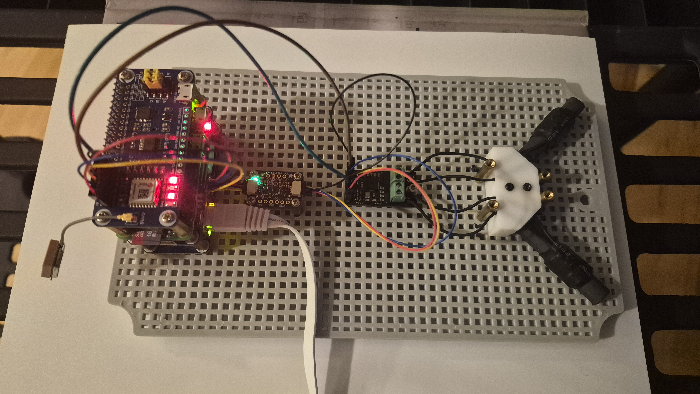

# Antenna Orientation and Long-Path Reception

This guide supplements the main [README](../README.md) with details on how the ES100 V-antenna and LSM303 compass axes relate to the incoming 60 kHz WWVB signal, how to read the `compass` and `orientate` output, and how to position the receiver in weak-signal or long-distance locations.

## Board Axes and the Ferrite V-Antenna



1. **`+X` axis (forward):** Points out through the open end of the ferrite V-antenna (toward the Raspberry Pi at the top of the carrier board).
2. **`+Z` axis (up):** Points straight up from the flat carrier board.
3. **Magnetic vs. True heading:**
   - `heading mag` is the clockwise angle from magnetic north (`0°`) to `+X`.
   - `dec` is the World Magnetic Model declination at the GPS fix (east positive, west negative).
   - `true = (mag + dec) mod 360`.
   - `brg` is the initial true great-circle bearing from the GPS position to the NIST WWVB transmitter in Fort Collins, Colorado (`40.678062° N, 105.046688° W`).
   - `turn` (or `off` in `orientate`) is the signed angle from `true` to `brg`:
     - **`clockwise`** (positive): rotate the board clockwise when viewed from above.
     - **`counterclockwise`** (negative): rotate the board counterclockwise when viewed from above.

## How Ferrite Loopstick Antennas Receive WWVB

Each cylinder in the V is a ferrite-rod loopstick antenna (an inductive coil wound around a ferrite core) tuned to 60 kHz:

- **Maximum pickup (0 dB):** When the incoming radio wave travels **perpendicular (broadside, 90°)** to the ferrite rod's length, so the alternating magnetic field lines pass straight through the axis of the rod.
- **Deep null:** When the rod points directly at or directly away from the transmitter (0° or 180°).

Because the two ferrite rods are mounted in a ~90° V centered on `+X` (at roughly $\pm 45^\circ$ from `+X`), there are two ways to orient the board.

---

## 1. Standard V-Split Orientation (Moderate Range, < 2,000 km)

Point the open end of the V (`+X`) directly at WWVB so `true` equals `brg` (`turn 0.0 deg`):

```text
WWVB bearing 278.1 deg at 2795.9 km  declination -13.8 deg  (open end of the V, along +X, points at WWVB)
heading mag 291.9  true 278.1  dec -13.8  brg 278.1  turn 0.0 deg
```

- **How it works:** Both Antenna 1 and Antenna 2 sit at $45^\circ$ to the incoming signal. Each rod receives $\cos(45^\circ) \approx 71\%$ (**−3 dB**) of peak field strength.
- **Advantage:** Every 134-second ES100 cycle (which alternates between Antenna 1 and Antenna 2) has equal signal strength on both antennas.
- **Required for `calibrate`:** `gps-wwvb calibrate` (and `calibrate --aim-only`) requires `+X` to stay within $\pm 5^\circ$ of `brg` for 5 consecutive samples before it marks the configuration `calibrated = true`.

---

## 2. Single-Rod Broadside Orientation (Weak Signal / Long Range, > 2,000 km)

At long distances (such as the US East Coast, ~2,800 km from Fort Collins) or indoors during the day, losing 3 dB by splitting the signal across both rods can leave both antennas just below the ES100 BPSK correlation threshold, resulting in repeated warnings:

```text
WARNING- WWVB: no reception on ant 1 (cycle complete)
WARNING- WWVB: no reception on ant 2 (cycle complete)
```

To recover the full **+3 dB** (100% pickup) on one antenna, rotate the board **45° clockwise or counterclockwise** from the WWVB bearing so that one ferrite rod is **broadside (90°)** to WWVB and the other is end-on. Pass `--ant 1` or `--ant 2` to `compass` (or `orientate`) so `turn` targets that antenna directly (`turn 0.0 deg` when broadside):

```bash
gps-wwvb compass --ant 2
gps-wwvb compass --ant 1
```

| Target | Command | `true` heading formula | Example (`brg = 278.1°`, `dec = -13.8°`) | Default `turn` (`--ant` omitted) | Effect |
| --- | --- | --- | --- | --- | --- |
| **V-Split (standard)** | `compass` | $\text{brg}$ | `true 278.1` (`mag 291.9`) | `0.0 deg` | Both Ant 1 & Ant 2 at ~71% (−3 dB) |
| **Peak Antenna 2 (−45°)** | `compass --ant 2` | $(\text{brg} - 45^\circ) \bmod 360^\circ$ | `true 233.1` (`mag 246.9`) | `45.0 deg clockwise` (`0.0 deg` with `--ant 2`) | **Ant 2** broadside (100%, 0 dB); Ant 1 in null |
| **Peak Antenna 1 (+45°)** | `compass --ant 1` | $(\text{brg} + 45^\circ) \bmod 360^\circ$ | `true 323.1` (`mag 336.9`) | `45.0 deg counterclockwise` (`0.0 deg` with `--ant 1`) | **Ant 1** broadside (100%, 0 dB); Ant 2 in null |
| **Reverse Ant 2 (+135°)** | — | $(\text{brg} + 135^\circ) \bmod 360^\circ$ | `true 53.1` (`mag 66.9`) | `135.0 deg counterclockwise` | **Ant 2** broadside (100%, 0 dB, 180° flipped) |
| **Reverse Ant 1 (−135°)** | — | $(\text{brg} - 135^\circ) \bmod 360^\circ$ | `true 143.1` (`mag 156.9`) | `135.0 deg clockwise` | **Ant 1** broadside (100%, 0 dB, 180° flipped) |

### Behavior in `gps-wwvb run` when rotated 45°

- Once `calibrated = true` is saved, `gps-wwvb run` does **not** warn or block startup when rotated within $45^\circ \pm 15^\circ$ of `brg`; instead it logs which antenna is optimized and disables the null-oriented antenna on the ES100:
  - `turn` near `+45 deg clockwise` (`+30°` to `+60°`): logs `Antenna: optimized for antenna 2 (skipping null antenna 1)` and writes `CONTROL0 = 0x03` (`START | ANT1_OFF`) so every 134-second cycle listens on **Antenna 2** only.
  - `turn` near `45 deg counterclockwise` (`-60°` to `-30°`): logs `Antenna: optimized for antenna 1 (skipping null antenna 2)` and writes `CONTROL0 = 0x05` (`START | ANT2_OFF`) so every 134-second cycle listens on **Antenna 1** only.
- Orientations outside both the $\pm 15^\circ$ V-split window and the $\pm 45^\circ \pm 15^\circ$ single-rod windows log the off-aim warning and alternate both antennas.

---

## Recalibrating When Moving Locations

Hard-iron magnetometer offsets (`mag_offset_x/y/z` and `mag_scale_x/y/z`) depend on the magnetic environment around the board and any magnetic remanence picked up during transport. Whenever the receiver is moved to a new location or desk:

1. **Run a fresh magnetometer sweep and aim check:**
   ```bash
   make remote ARGS='--config /etc/gps_wwvb.toml calibrate'
   ```
   - First, rotate the board through all orientations for 30 seconds.
   - Next, point `+X` at the WWVB bearing (`turn` within $\pm 5^\circ$) until it reports `Marked /var/lib/gps-wwvb/calibration.toml calibrated.`
2. **Optional weak-signal adjustment:**
   - If you need single-rod broadside reception for a long path, run `make remote ARGS='compass --ant 2'` (or `compass --ant 1`) and turn the board until `turn` reads `0.0 deg`.
3. **Restart the background service:**
   - Remember that `compass`, `orientate`, and `calibrate` disable the ES100 while they run and leave `gps-wwvb.service` stopped. Always restart the service when finished:
   ```bash
   make svc-start
   make logs
   ```

## Other Reception Tips

- **Scheduled WWVB maintenance windows:** WWVB drops carrier power from **minute 10 to 16** and **minute 40 to 46** of every hour. `gps-wwvb` holds reception starting 134 seconds before each window (`:07:46` and `:37:46`).
- **Day vs. night propagation:** 60 kHz skywave propagation improves significantly after sunset along the path between Colorado and the receiver, and during the sunrise/sunset terminator transitions wait a few cycles if multipathing occurs.
- **Local 60 kHz RFI:** Switching power supplies, USB chargers, laptop screens, LED dimmers, and Ethernet/HDMI cables emit strong broadband noise around 60 kHz. Place the ferrite V near an exterior wall or window facing west and keep power bricks and monitors at least 1–2 feet away from the ferrite rods.
